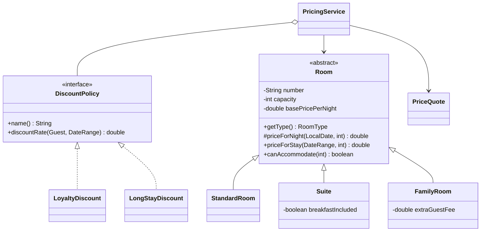
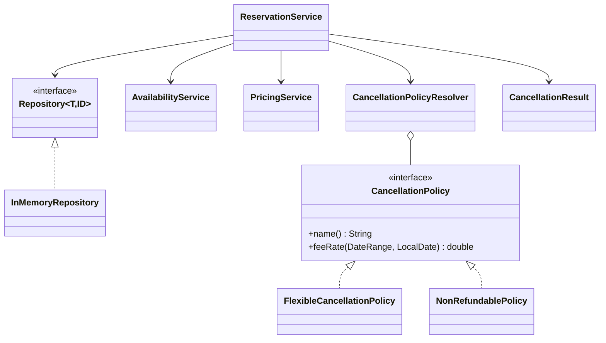
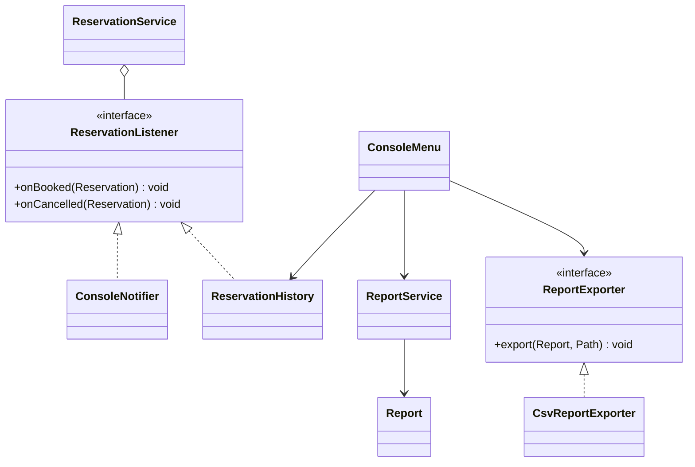

# Organisation du projet

Le menu appelle les services, les services appliquent les règles, et les données restent
dans des dépôts en mémoire. La lecture et l'écriture des CSV sont regroupées dans `io`.

## Les chambres et les prix

Toutes les chambres partagent les informations de `Room`. Chaque sous-classe définit
le prix d'une nuit ; `priceForStay()` additionne ensuite les nuits du séjour.
Les remises sont calculées à part et seule la meilleure est retenue.

`Reservation` garde le client, la chambre, le séjour, le devis et son statut.
Le prix du devis reste donc celui de la réservation, même si les tarifs changent plus tard.
`DateRange` exclut le jour du départ : une arrivée le jour où un autre client part ne crée pas de conflit.

## Créer ou annuler une réservation

Pour réserver, `ReservationService` vérifie la date, le client, la chambre, la capacité
et les disponibilités. Il calcule ensuite le prix et enregistre la réservation.

Pour annuler, il vérifie que le jour d'arrivée n'est pas passé.
`CancellationPolicyResolver` choisit la règle : flexible pour `STANDARD` et `FAMILY`,
non remboursable pour `SUITE`. Les frais et le remboursement sont calculés sur le prix
final conservé dans la réservation. Le résultat est renvoyé dans `CancellationResult`.

Le service utilise un `Clock` reçu par constructeur. Les tests peuvent ainsi fixer
la date du jour et vérifier les cas limites sans dépendre de la date réelle.

## L'historique et les rapports

Après une réservation ou une annulation réussie, le service prévient ses abonnés.
`ConsoleNotifier` affiche une confirmation et `ReservationHistory` garde la trace de l'opération.
L'import et les opérations refusées ne déclenchent pas ces événements.

`ReportService` calcule les revenus et le meilleur client sur toutes les réservations actives.
Il utilise la période demandée uniquement pour le taux d'occupation.
Les réservations annulées et leurs frais n'entrent pas dans ces chiffres.
Le résultat est un `Report`, dont la table de revenus ne peut pas être modifiée depuis l'extérieur.

`CsvReportExporter` écrit ce résultat en UTF-8 dans `reports/report-<date>.csv`.
Il crée le dossier si besoin et remplace le fichier lors d'un nouvel export le même jour.
Si l'écriture échoue, le menu affiche l'erreur et reste utilisable.

## Au démarrage

`Application` crée les dépôts, les services et leurs dépendances, puis lance l'import
avant d'ouvrir le menu. `DataImportService` passe par `HotelDataSource`, implémentée
ici par `CsvHotelDataSource`.

L'import charge les chambres, puis les clients, puis les réservations.
Les anciennes réservations peuvent être dans le passé, mais elles doivent respecter
la capacité et les disponibilités. Une réservation impossible est signalée et ignorée.
Une erreur de lecture ou de format arrête le démarrage avec le fichier et la ligne concernés.

Pendant l'utilisation, le menu intercepte les `BookingException` et explique le refus.
Il traite aussi les arguments invalides, les doubles annulations et les erreurs d'export.
