# Architecture

```mermaid
classDiagram
    class Room {
        <<abstract>>
        -String number
        -int capacity
        -double basePricePerNight
        +getType() RoomType*
        #priceForNight(LocalDate, int) double*
        +priceForStay(DateRange, int) double
        +canAccommodate(int) boolean
    }
    Room <|-- StandardRoom
    Room <|-- Suite
    Room <|-- FamilyRoom
    class Suite { -boolean breakfastIncluded }
    class FamilyRoom { -double extraGuestFee }

    class DiscountPolicy {
        <<interface>>
        +name() String
        +discountRate(Guest, DateRange) double
    }
    DiscountPolicy <|.. LoyaltyDiscount
    DiscountPolicy <|.. LongStayDiscount
    PricingService o-- DiscountPolicy

    class CancellationPolicy {
        <<interface>>
        +name() String
        +feeRate(DateRange, LocalDate) double
    }
    CancellationPolicy <|.. FlexibleCancellationPolicy
    CancellationPolicy <|.. NonRefundablePolicy
    CancellationPolicyResolver o-- CancellationPolicy : EnumMap by RoomType
    ReservationService --> CancellationPolicyResolver
    class CancellationResult {
        <<record>>
        +Reservation reservation
        +double fee
        +double refund
    }
    ReservationService --> CancellationResult

    class ReservationListener {
        <<interface>>
        +onBooked(Reservation) void
        +onCancelled(Reservation) void
    }
    ReservationListener <|.. ConsoleNotifier
    ReservationListener <|.. ReservationHistory
    ReservationService o-- ReservationListener : subscribers
    ConsoleMenu --> ReservationHistory

    class Report {
        <<record>>
        +DateRange period
        +Map revenueByRoomType
        +double totalRevenue
        +double occupancyRate
        +String bestCustomerName
    }
    class ReportExporter {
        <<interface>>
        +export(Report, Path) void
    }
    ReportExporter <|.. CsvReportExporter
    ReportService --> Report : builds snapshot
    ConsoleMenu --> ReportExporter
    CsvReportExporter --> DataExportException

    class Repository~T,ID~ { <<interface>> }
    Repository <|.. InMemoryRepository

    class HotelDataSource { <<interface>> }
    HotelDataSource <|.. CsvHotelDataSource

    Reservation --> Guest
    Reservation --> Room
    Reservation --> DateRange
    Reservation --> PriceQuote

    ReservationService --> Repository
    ReservationService --> AvailabilityService
    ReservationService --> PricingService
    ReportService --> Repository
    DataImportService --> HotelDataSource
    DataImportService --> ReservationService
    ConsoleMenu --> ReservationService
    ConsoleMenu --> ReportService
    BookingException <|-- RoomUnavailableException
    BookingException <|-- CapacityExceededException
    BookingException <|-- RoomNotFoundException
```

## Application flow

1. `Application` creates repositories, pricing/cancellation rules and services (composition root),
   injects one `Clock`, subscribes the console notifier/history, and supplies the CSV report exporter.
2. `DataImportService` loads rooms, guests, then existing reservations from the CSV files.
3. Each existing reservation is checked by `ReservationService` (conflicts, capacity); invalid ones are reported.
4. `ConsoleMenu` lets the user search, quote, book, cancel, view history and see/export reports.
5. A successful user booking/cancellation notifies the observers after the state change. Imports and
   refused operations are silent. Cancellation selects its policy through the resolver and returns
   a `CancellationResult` with the fee and refund of the frozen final price.
6. `ReportService` builds a `Report` snapshot: global active revenue/best customer and occupancy
   within the requested period. Cancelled reservations, including their fees, are excluded.
7. `CsvReportExporter` creates parent directories and writes UTF-8 to `reports/report-<date>.csv`.
   A repeated same-day export replaces the file. `DataExportException` preserves the `IOException`;
   the menu displays the error and continues.
8. Business errors (`BookingException`) are caught in the menu; invalid arguments/states have their
   own messages. Technical loading errors at startup stop the app with a clear message.
