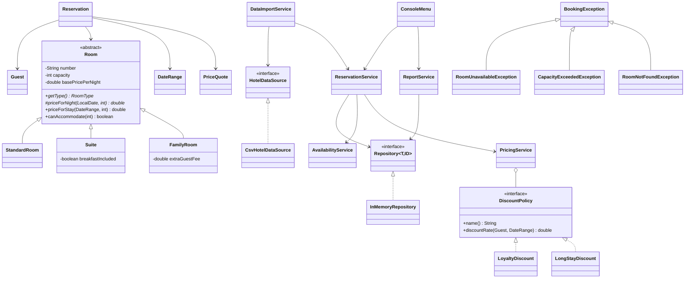

# Architecture

## Application flow

1. `Application` creates the repositories and services and passes them their dependencies.
   It supplies a `Clock` to the reservation service.
2. `DataImportService` loads rooms, guests, then reservations. Imported stays can be in the past.
   `ReservationService` checks the guest, room, capacity and conflicts; refused bookings are reported and skipped.
3. `ConsoleMenu` reads the user's choice and calls the service for that operation.
4. `ReportService` calculates revenue and the best customer from all active reservations.
   Occupancy uses the period entered in the menu.
5. The menu shows business errors and invalid input, then accepts another choice.
   A loading error at startup stops the program.
