# Architecture

```mermaid
classDiagram
    class Room {
        <<abstract>>
        -String number
        -int capacity
        -double basePricePerNight
        +getType() RoomType*
        #priceForNight(LocalDate, int) double*
        +priceForStay(DateRange, int) double
        +canAccommodate(int) boolean
    }
    Room <|-- StandardRoom
    Room <|-- Suite
    Room <|-- FamilyRoom
    class Suite { -boolean breakfastIncluded }
    class FamilyRoom { -double extraGuestFee }

    class DiscountPolicy {
        <<interface>>
        +name() String
        +discountRate(Guest, DateRange) double
    }
    DiscountPolicy <|.. LoyaltyDiscount
    DiscountPolicy <|.. LongStayDiscount
    PricingService o-- DiscountPolicy

    class CancellationPolicy {
        <<interface>>
        +name() String
        +feeRate(DateRange, LocalDate) double
    }
    CancellationPolicy <|.. FlexibleCancellationPolicy
    CancellationPolicy <|.. NonRefundablePolicy
    CancellationPolicyResolver o-- CancellationPolicy : EnumMap by RoomType
    ReservationService --> CancellationPolicyResolver
    class CancellationResult {
        <<record>>
        +Reservation reservation
        +double fee
        +double refund
    }
    ReservationService --> CancellationResult

    class ReservationListener {
        <<interface>>
        +onBooked(Reservation) void
        +onCancelled(Reservation) void
    }
    ReservationListener <|.. ConsoleNotifier
    ReservationListener <|.. ReservationHistory
    ReservationService o-- ReservationListener : subscribers
    ConsoleMenu --> ReservationHistory

    class Report {
        <<record>>
        +DateRange period
        +Map revenueByRoomType
        +double totalRevenue
        +double occupancyRate
        +String bestCustomerName
    }
    class ReportExporter {
        <<interface>>
        +export(Report, Path) void
    }
    ReportExporter <|.. CsvReportExporter
    ReportService --> Report : builds
    ConsoleMenu --> ReportExporter
    CsvReportExporter --> DataExportException

    class Repository~T,ID~ { <<interface>> }
    Repository <|.. InMemoryRepository

    class HotelDataSource { <<interface>> }
    HotelDataSource <|.. CsvHotelDataSource

    Reservation --> Guest
    Reservation --> Room
    Reservation --> DateRange
    Reservation --> PriceQuote

    ReservationService --> Repository
    ReservationService --> AvailabilityService
    ReservationService --> PricingService
    ReportService --> Repository
    DataImportService --> HotelDataSource
    DataImportService --> ReservationService
    ConsoleMenu --> ReservationService
    ConsoleMenu --> ReportService
    BookingException <|-- RoomUnavailableException
    BookingException <|-- CapacityExceededException
    BookingException <|-- RoomNotFoundException
    BookingException <|-- CancellationNotAllowedException
```

## Application flow

1. `Application` creates the repositories and services and passes them their dependencies.
   It shares one `Clock` between the reservation service and menu, and registers the notifier and history.
2. `DataImportService` loads rooms, guests, then reservations. Imported stays can be in the past.
   `ReservationService` checks the guest, room, capacity and conflicts; refused bookings are reported and skipped.
3. `ConsoleMenu` reads the user's choice and calls the service for that operation.
4. After a successful booking or cancellation, `ReservationService` calls the listeners.
   `ConsoleNotifier` prints the confirmation and `ReservationHistory` adds an entry.
   Imports and failed operations do not call the listeners.
5. `ReportService` builds the report from active reservations. Revenue and the best customer cover all
   dates; occupancy uses the requested period. For export, the menu chooses `reports/report-<date>.csv`.
   `CsvReportExporter` creates the directory and writes UTF-8, replacing an existing file at that path.
6. The menu shows errors from bookings, invalid input and exports, then accepts another choice.
   A loading error at startup stops the program. Loading and export exceptions preserve the original
   cause when one is available.
